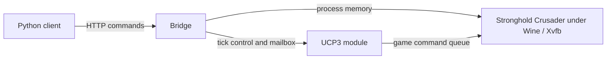

# Crusader SDK


<sub>Gameplay screenshot from Stronghold Crusader, © Firefly Studios, captured from a game driven through this SDK.</sub>

[](https://github.com/smwitkowski/crusader-sdk/actions/workflows/ci.yml)
[](LICENSE)
[](https://docs.astral.sh/ruff/)
[](https://github.com/microsoft/pyright)
[](https://pypi.org/project/crusader-sdk/)
[](https://pypi.org/project/crusader-sdk/)
[](https://codecov.io/gh/smwitkowski/crusader-sdk)

A Python SDK for observing and controlling Stronghold Crusader through a local bridge. Read game state, inspect the map, and issue commands from Python.

Unofficial; not affiliated with or endorsed by Firefly Studios. You must provide your own supported game files. See [LEGAL.md](LEGAL.md).

## Client example

With a bridge already running locally:

```python
from crusader import CrusaderError, Game

try:
    game = Game.connect()
    state = game.state()
    print(f"Tick: {state['tick']}")
    print(game.map(0, 0, 20, 20))
    print(game.advance(100))  # advances the game by 100 ticks
except CrusaderError as exc:
    print(f"Request failed: {exc}")
```

## How it works



The real backend runs or attaches to the supported game under Linux/Wine. The port and Docker integration have only been tested offline and still need a live game run. See [how it works](docs/how-it-works.md).

## Get started

1. Supply your own supported game files and [set up the bridge](docs/quickstart.md#run-the-bridge).
2. From a checkout, [install the client](docs/quickstart.md#install-the-client) with `python -m pip install .`.
3. Connect to the running bridge and [try the client](docs/quickstart.md#install-the-client).

See the [quickstart](docs/quickstart.md) for bridge setup, requirements, and the experimental Docker option.

## Explore

| | |
| --- | --- |
| [Documentation](docs/index.md) | [API reference](docs/api.md) |
| [LLM guide](llms.txt) | [Protocol](docs/protocol.md) |
| [How it works](docs/how-it-works.md) | [Contributing](CONTRIBUTING.md) |
| [Security](SECURITY.md) | [Legal](LEGAL.md) |
