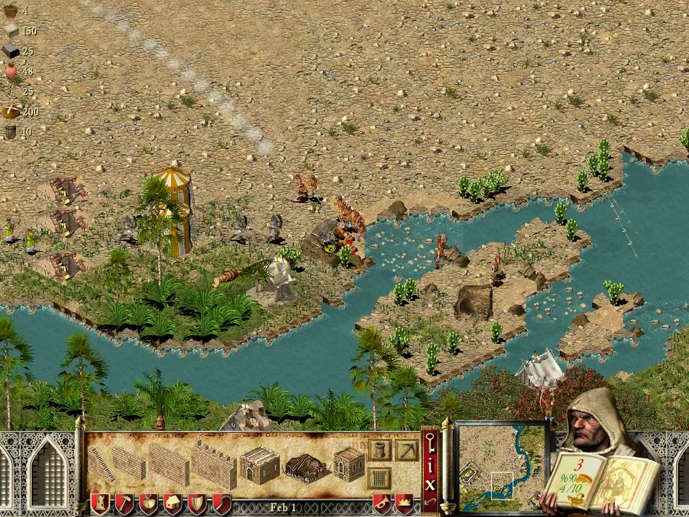
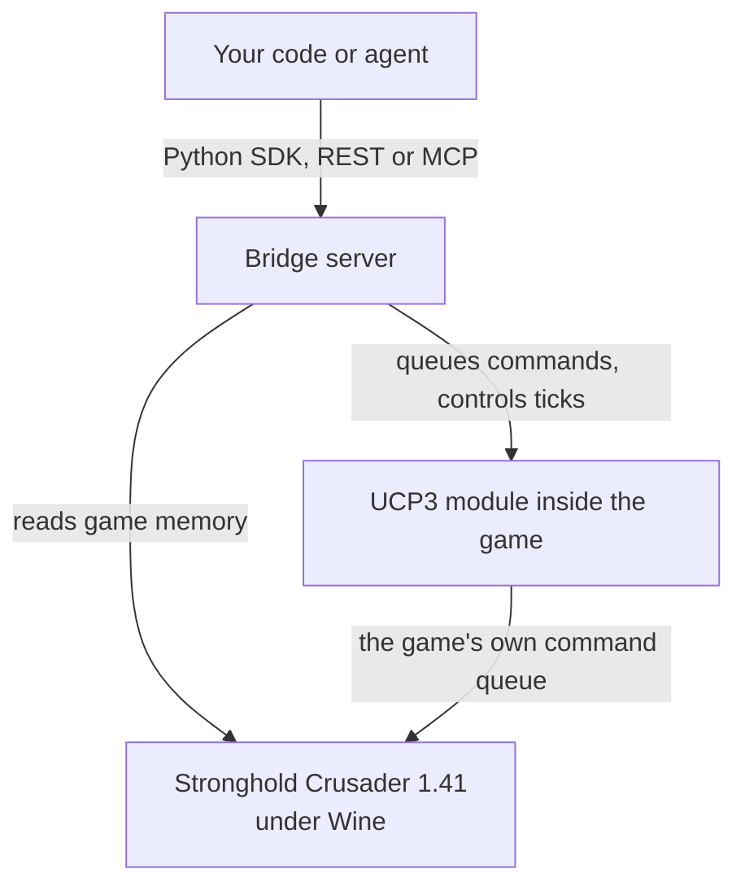

# Crusader SDK



<sub>Gameplay screenshot from Stronghold Crusader, © Firefly Studios, captured from a game driven through this SDK.</sub>

[](https://github.com/smwitkowski/crusader-sdk/actions/workflows/ci.yml)
[](LICENSE)
[](https://docs.astral.sh/ruff/)
[](https://github.com/microsoft/pyright)
[](https://pypi.org/project/crusader-sdk/)
[](https://pypi.org/project/crusader-sdk/)
[](https://codecov.io/gh/smwitkowski/crusader-sdk)

A Python SDK for observing and controlling Stronghold Crusader through a local bridge. Read game state, inspect the map, and issue commands from Python.

Unofficial; not affiliated with or endorsed by Firefly Studios. You must provide your own supported game files. See [LEGAL.md](LEGAL.md).

## Client example

With a bridge running (see [Get started](#get-started)), play a month of the game from Python:

```python
from crusader import CrusaderError, Game

game = Game.connect()  # CRUSADER_URL and CRUSADER_TOKEN are read from the environment
print(game.state()["gold"], "gold at tick", game.state()["tick"])

site = game.find_sites("granary", limit=1)[0]  # the game's own placement check
game.build("granary", site["x"], site["y"])
game.set_tax(2)

result = game.advance(800)  # one game month (800 ticks); the game is paused otherwise
for event in result["events"]:
    print(event["type"], event.get("message", ""))

try:
    game.set_tax(42)
except CrusaderError as exc:  # refusals come back as errors, like the game's UI
    print("refused:", exc)
```

## How it works



Commands go through the same command queue the game's UI uses, so the game applies its own costs and rules. The game
stays paused between calls; time moves only when you call `advance`. Details: [how it works](docs/how-it-works.md).
The Docker setup has been verified live: `tools/smoke.py` passes all 12 steps against a fresh skirmish.

## Get started

1. Supply your own supported game files and [set up the bridge](docs/quickstart.md#run-the-bridge).
2. [Install the client](docs/quickstart.md#install-the-client): `pip install --pre crusader-sdk` (pre-release for now).
3. Connect to the running bridge and [try the client](docs/quickstart.md#install-the-client).

See the [quickstart](docs/quickstart.md) for bridge setup, requirements, and the experimental Docker option.

## Explore

| | |
| --- | --- |
| [Documentation](docs/index.md) | [API reference](docs/api.md) |
| [LLM guide](llms.txt) | [Protocol](docs/protocol.md) |
| [How it works](docs/how-it-works.md) | [Contributing](CONTRIBUTING.md) |
| [Security](SECURITY.md) | [Legal](LEGAL.md) |
